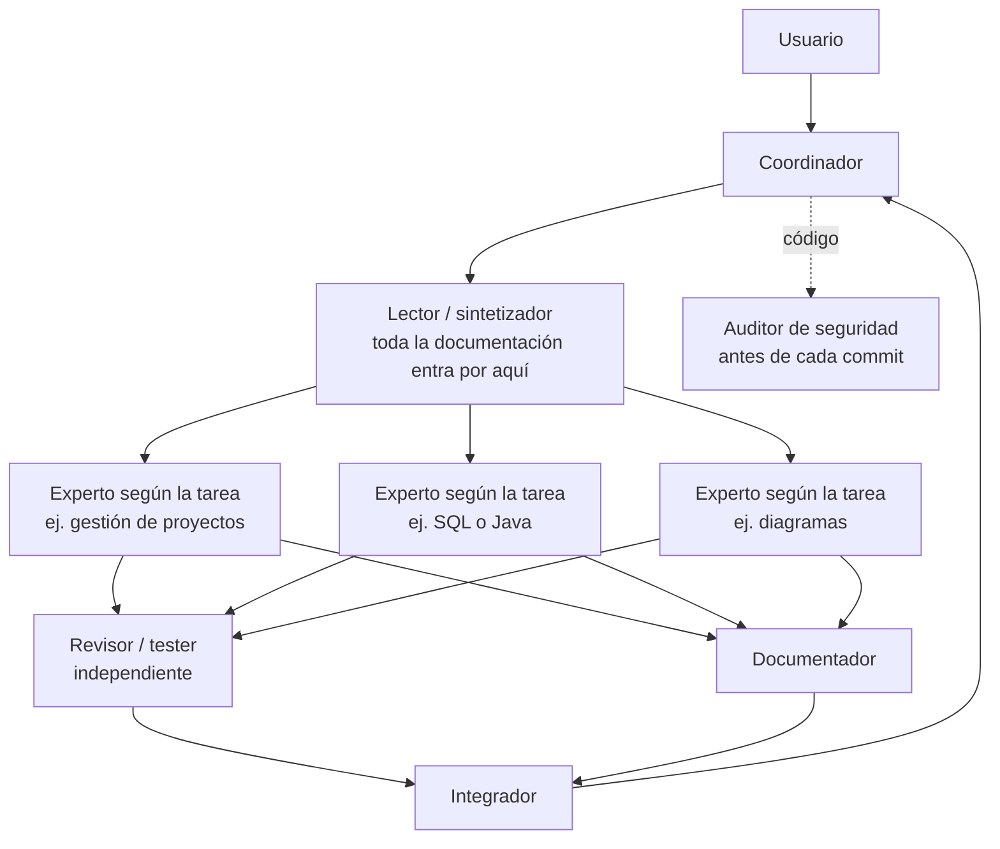

# multiagente-kev

**Flujo de trabajo multiagente para Claude**, con un coordinador que arma un equipo de subagentes expertos según la tarea y un tablero en vivo para seguir quién hace qué.

Creado por **Kevin Villalobos Obando** (Costa Rica, 2026). Licencia MIT.

---

## El problema

Cuando un trabajo tiene muchas partes (varias matrices de un proyecto, un informe con anexos, una aplicación con varios módulos) y se hace todo en una sola conversación con un modelo de lenguaje, el contexto se llena rápido. A partir de ahí se pierden detalles, se mezclan secciones y la calidad baja hacia el final. Además, el mismo modelo revisa su propio trabajo y tiende a no ver sus errores.

## La solución

Una skill que convierte a Claude en **coordinador**. En lugar de hacer todo, el coordinador:

1. Lee solo el enunciado y la rúbrica, y propone un equipo.
2. **Pregunta antes** si conviene usar multiagentes, explicando qué ahorra y qué cuesta. En tareas de una sola parte ni siquiera lo propone.
3. Reparte el trabajo entre subagentes que trabajan **en paralelo**, cada uno con su propio contexto.
4. Recibe solo resúmenes cortos; el trabajo queda en archivos. Así su contexto dura todo el proyecto.



## Qué incluye

- **Expertos según la tarea.** Una tabla guía (diagramas, Java, Flutter, SQL, arquitectura, datos, gestión de proyectos, diseño de interfaces, redes, redacción académica…) que el coordinador amplía cuando la tarea pide otra disciplina.
- **Agentes fijos.** Lector/sintetizador, revisor/tester y documentador en todo trabajo; en código, además, tester de pruebas y auditor de seguridad.
- **Lector como única puerta del material.** Clasifica cada documento como directo para un experto, compartido (va a un resumen con fuente y página) o crítico (va tal cual a la memoria del proyecto).
- **Compuerta de seguridad.** Ningún commit pasa sin que el auditor revise secretos, `.env`, llaves, datos personales reales y vulnerabilidades básicas.
- **Memoria del proyecto en archivos.** `contexto-compartido.md`, `estado-proyecto.md`, `mapa-material.md` y bitácoras por agente. Si la conversación se compacta, el coordinador relee esos archivos y sigue sin perder decisiones.
- **Relevos.** Si un agente se satura, deja su bitácora al día y otro con el mismo rol sigue desde donde quedó. El coordinador también se puede relevar a una conversación nueva sin relanzar agentes de partes terminadas.
- **Respaldo.** Si la sesión no permite subagentes, trabaja en una sola conversación con todo lo demás.

## Tablero de agentes

La skill crea (una sola vez) una página privada en la cuenta del usuario que muestra cada proyecto en vivo:

- Barra de etapas: Lectura → Producción → Revisión → Integración → Entrega.
- El coordinador arriba y cada agente debajo con su ícono, estado, etapa, acción actual y archivo; los agentes relevados aparecen atenuados.
- Una casilla por agente para dejarle **sugerencias** y **arrastrar archivos** de cualquier tipo (Word, Excel, PDF, `.py`, `.sql`…, hasta 5 MB). El coordinador las entrega al agente correcto y confirma en el chat.
- Funciona en el teléfono y en la computadora, con tema claro y oscuro.

El diseño viaja dentro de la skill (`skills/multiagente-kev/assets/tablero-agentes.html`); los datos viven en la cuenta de cada usuario, con acceso solo para el dueño.

## Instalación

**En claude.ai (web, escritorio o móvil):** descargá [`dist/multiagente-kev.zip`](dist/multiagente-kev.zip) y subilo en la sección de skills de la configuración.

**En Claude Code:**

```
/plugin install multiagente-kev --marketplace KevViOb/multiagente-kev
```

## Requisitos

- Una sesión de Claude con la herramienta de subagentes para el modo multiagente.
- El Tablero de agentes necesita las páginas (artifacts) de claude.ai: funciona en la web y en la app de escritorio, incluido el modo Code. En Claude Code desde la terminal la skill sigue funcionando y muestra el avance como árbol en texto.
- Las skills `sdd-kev`, `academic-kev`, `sql-advanced-kev` y otras que menciona son complementos opcionales: sin ellas, cada experto aplica el estándar general de su disciplina.

## Decisiones de diseño

- **Preguntar antes de lanzar agentes**, porque cada agente consume más uso del plan; la skill solo lo propone cuando de verdad conviene.
- **Resúmenes de 10 líneas y trabajo en archivos**, para que el contexto del coordinador sea lo último en llenarse.
- **Un lector fijo**, aunque haya pocos documentos, porque el material de un proyecto suele crecer después.
- **Relevos por señales, no por porcentaje**, porque ni el coordinador ni los agentes pueden medir con exactitud su contexto.
- **Tablero con escrituras solo en cambios de estado**, sin sondeo, para que verlo en vivo cueste poco.
- **Archivos adjuntos partidos en trozos** dentro de la base de datos privada del tablero, para aceptar cualquier tipo de archivo, incluidos Word y Excel.

## Estructura

```
.claude-plugin/          manifiesto del plugin y del marketplace (Claude Code)
skills/multiagente-kev/
  SKILL.md               el flujo completo
  assets/                diseño del Tablero de agentes
  scripts/               reconstrucción de archivos adjuntos
dist/                    zip listo para subir a claude.ai
```

## Licencia

MIT © 2026 Kevin Villalobos Obando. Cualquier copia o versión modificada debe conservar el aviso de autoría y la licencia.
